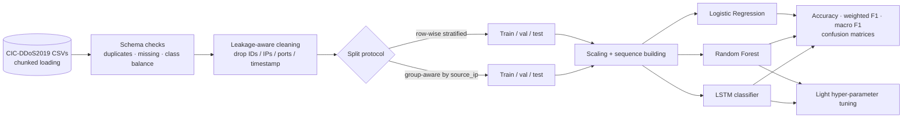
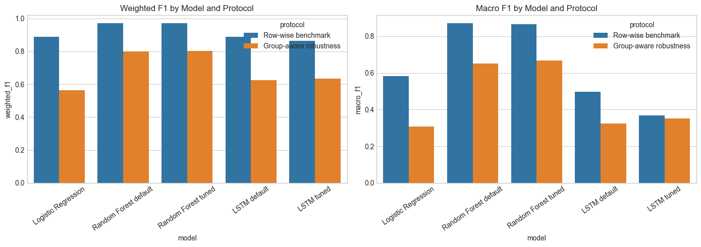

<div align="center">

# 🌐 DDoS Attack Detection — Leakage-Aware Evaluation on CIC-DDoS2019

**LSTM vs. classical ML on network-flow data, with a strict source-IP-aware protocol that exposes how optimistic naive splits are.**


</div>

---

## 📌 Overview

This project builds a reproducible pipeline to classify DDoS traffic from the **CIC-DDoS2019** flow dataset: exploration → cleaning → training → testing → evaluation → tuning. It compares a **PyTorch LSTM** over short flow sequences with **Logistic Regression** and **Random Forest** baselines.

Its main contribution is methodological: the same models are evaluated under two protocols —

1. **Row-wise split** (the usual benchmark), and
2. **Group-aware split by `source_ip`**, which prevents flows from the same attacker appearing in both train and test.

The gap between the two shows how much of the “easy” benchmark score comes from leakage rather than generalisation.

## 🎯 Objectives

- Build a clean, phase-by-phase pipeline (single protocol → multi-class → larger subset).
- Detect and drop **leakage-prone columns** (`Flow ID`, IPs, ports, timestamp, …).
- Compare sequence (LSTM) and tabular (RF/LR) models fairly.
- Report results under a **leakage-reduced** protocol, not only the optimistic one.

## 🧭 Pipeline



### Phases implemented in [`ddos_lstm_project.py`](./ddos_lstm_project.py)

| Phase | Scope |
|---|---|
| `phase1_dns_binary` | Pipeline validation on a DNS subset (binary, ≤ 80k rows) |
| `phase2_multiclass_subset` | 5 classes from 4 files (DNS, NTP, NetBIOS, Portmap), ≤ 200k rows |
| `phase3_scaling_subset` | Chunked scaling to 8 files (≤ 260k rows) |
| `phase25_multiclass_groupaware` | Phase 2 with a strict `source_ip`-aware split |
| `phase25b_multiclass_groupaware_train_test` | Strict train/test source-IP robustness check |

## 🧠 Models

- **LSTM classifier** (PyTorch): 1-layer LSTM → dropout → `Linear(h, h/2)` → ReLU → dropout → `Linear(h/2, classes)`, applied to sequences built from the previous flows of the same `source_ip` (ordered by timestamp, zero-padded at the start); tuned over sequence length, hidden size and dropout.
- **Random Forest** and **Logistic Regression** baselines (scikit-learn); RF tuned with `RandomizedSearchCV`.

## 🗂️ Data

[CIC-DDoS2019](https://www.unb.ca/cic/datasets/ddos-2019.html) (Canadian Institute for Cybersecurity). The CSVs are **not** in this repository. The multi-class experiment uses 200,000 sampled flows:

| Class | Flows |
|---|---:|
| DrDoS_NetBIOS | 49,839 |
| DrDoS_DNS | 48,298 |
| Portmap | 45,283 |
| DrDoS_NTP | 37,653 |
| BENIGN | 18,927 |

## 📊 Results (rigorous Colab notebook, 5 classes)

| Protocol | Model | Accuracy | Weighted F1 | Macro F1 |
|---|---|---:|---:|---:|
| Row-wise | Logistic Regression | 0.8775 | 0.8884 | 0.5830 |
| Row-wise | Random Forest (default) | **0.9712** | **0.9707** | **0.8701** |
| Row-wise | Random Forest (tuned) | 0.9712 | 0.9708 | 0.8660 |
| Row-wise | LSTM (default) | 0.9038 | 0.8901 | 0.4969 |
| Row-wise | LSTM (tuned) | 0.8750 | 0.8642 | 0.3689 |
| **Group-aware** | Logistic Regression | 0.6702 | 0.5648 | 0.3076 |
| **Group-aware** | Random Forest (default) | **0.8255** | **0.8005** | **0.6500** |
| **Group-aware** | Random Forest (tuned) | 0.8268 | 0.8014 | 0.6668 |
| **Group-aware** | LSTM (default) | 0.6782 | 0.6257 | 0.3245 |
| **Group-aware** | LSTM (tuned) | 0.6899 | 0.6352 | 0.3525 |

<p align="center">
  
</p>

**Findings**

- **Random Forest is the strongest model** in this study; CIC-DDoS2019 is fundamentally tabular.
- Every model drops sharply under the group-aware protocol → the row-wise benchmark is **optimistic** (flows from the same source IP leak across splits).
- The LSTM did **not** outperform Random Forest here; light tuning gave only small gains under the strict protocol.
- An ablation removing the `inbound` feature degraded Logistic Regression accuracy from 0.6702 to 0.3588, showing strong reliance on a single feature.

**Caveats:** results come from sampled subsets (≤ 200k flows) and single runs. In the strict protocol the internal validation fell back to row-wise splitting because a class-preserving group split was infeasible, and the printed RF cross-validation score was `nan` — treat tuning conclusions cautiously.

## ✅ Verification Status

Metrics were copied from the executed `…rigorous_autonomous_colab.ipynb` outputs; the notebooks and `ddos_lstm_project.py` were **not re-run** (the CIC-DDoS2019 CSVs are not in the repository). `xgboost` is optionally imported by the script but is absent from `requirements.txt`.

## 🧰 Tech Stack

| Role | Tools |
|---|---|
| Core | Python, NumPy, pandas |
| Machine learning | scikit-learn, imbalanced-learn |
| Deep learning | PyTorch (LSTM) |
| Visualisation | matplotlib, seaborn |
| Environment | Jupyter / Google Colab notebooks (EN + FR versions) |

## 🗂️ Repository Structure

```text
.
├── ddos_lstm_project.py                                  # End-to-end pipeline (CLI)
├── ddos_lstm_project_notebook.ipynb                      # Local notebook
├── ddos_lstm_project_autonomous_hybrid_colab.ipynb       # Colab notebook
├── ddos_lstm_project_rigorous_autonomous_colab.ipynb     # Rigorous protocol (reported results)
├── ddos_lstm_project_rigorous_autonomous_colab_fr.ipynb  # French version
└── requirements.txt
```

## 🚀 Run

```bash
pip install -r requirements.txt

# All phases
python ddos_lstm_project.py --base-dir . --output-dir outputs

# A single phase
python ddos_lstm_project.py --base-dir . --output-dir outputs --phase phase1_dns_binary
```

`--base-dir` must contain the CIC-DDoS2019 folders (`01-12/…`, `03-11/…`).

## 🔭 Limitations & Future Work

- Evaluate on the full dataset and across multiple seeds; report confidence intervals.
- Hold out entire **attack days / source IPs** consistently in all phases.
- Investigate why the LSTM underperforms RF (sequence construction, class imbalance, feature set).
- Add per-class precision/recall tables and calibration analysis.

## 👤 Author

**Nour Ghribi** · [GitHub](https://github.com/Nour-Ghribi)

## 📚 References

- Sharafaldin et al., *Developing Realistic Distributed Denial of Service (DDoS) Attack Dataset and Taxonomy*, IEEE ICCST 2019.
